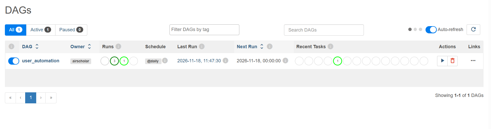
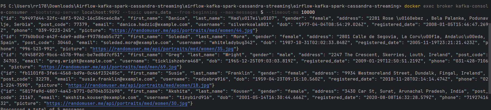
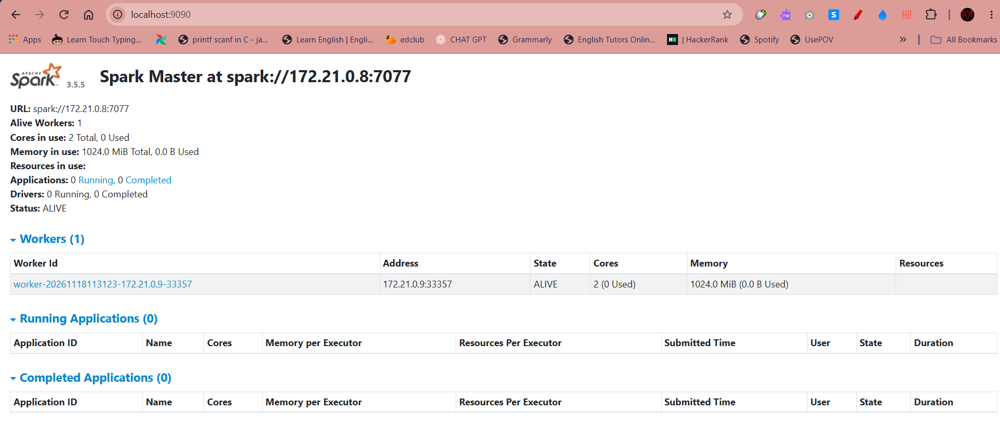
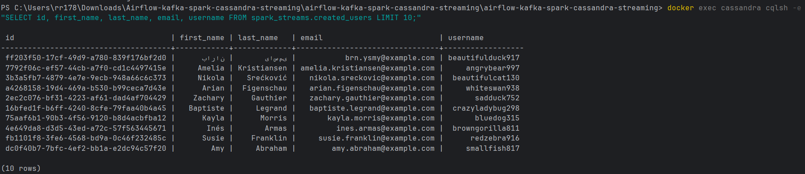
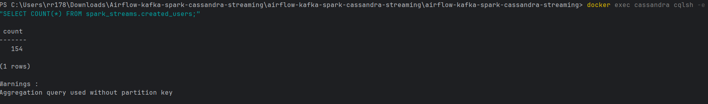

# Real-Time User Data Streaming Pipeline
### End-to-End Data Engineering Project | Airflow · Kafka · Spark · Cassandra

## Project Overview

Built an end-to-end data engineering pipeline that ingests user data from an external REST API, streams events through Apache Kafka, processes them using Apache Spark Structured Streaming, and persists the results in Apache Cassandra.

Apache Airflow orchestrates the ingestion workflow, while Docker Compose provides the containerized environment for the pipeline components.

The project demonstrates practical experience with API ingestion, workflow orchestration, event streaming, distributed data processing, and NoSQL data storage.
## Architecture

The following diagram illustrates the system architecture and the flow of data from API ingestion through orchestration and stream processing to Cassandra storage.


**Data flow:** RandomUser API → Python ingestion → Apache Airflow → Apache Kafka → Apache Spark Structured Streaming → Apache Cassandra.

**Supporting components:**
- **PostgreSQL:** Airflow metadata database.
- **Apache Zookeeper:** Kafka cluster coordination.
- **Docker:** Containerized project environment.

## Technology Stack

| Component | Technology | Purpose |
|---|---|---|
| Data Source | RandomUser API | Generates user records |
| Programming | Python | API ingestion and data handling |
| Orchestration | Apache Airflow | Schedules and manages ingestion |
| Message Broker | Apache Kafka | Streams user events |
| Coordination | Apache Zookeeper | Kafka cluster coordination |
| Stream Processing | Apache Spark 3.5.5 | Structured Streaming |
| NoSQL Database | Apache Cassandra | Stores processed user records |
| Metadata Database | PostgreSQL | Airflow metadata storage |
| Containerization | Docker & Docker Compose | Runs project services |

## Pipeline Implementation

### 1. Data Ingestion
- Connected to the RandomUser REST API.
- Extracted user information in JSON format.
- Structured the records with fields such as user ID, name, email, address, username, and phone number.
- Implemented Python-based ingestion within an Airflow task.

### 2. Workflow Orchestration
- Configured an Apache Airflow DAG named `user_automation`.
- Implemented the `stream_data_from_api` task.
- Used Airflow to trigger and monitor the ingestion workflow.

### 3. Event Streaming with Kafka
- Configured a Kafka topic named `users_data`.
- Published API-generated user records as JSON messages.
- Used Kafka as the event streaming layer between ingestion and processing.

### 4. Stream Processing with Spark
- Implemented a Spark Structured Streaming application.
- Consumed JSON messages from Kafka.
- Defined a schema to parse incoming user records.
- Filtered records with missing user IDs.
- Used `foreachBatch` to write processed micro-batches to Cassandra.

### 5. Data Storage with Cassandra
- Created the `spark_streams` keyspace.
- Created the `created_users` table.
- Stored processed records using the user ID as the primary key.
- Validated the stored data using Cassandra CQL queries.

## Data Schema

The `spark_streams.created_users` table contains:

| Column | Description |
|---|---|
| id | Unique user identifier |
| first_name | User's first name |
| last_name | User's last name |
| gender | User gender |
| address | User address |
| post_code | Postal code |
| email | Email address |
| username | User's username |
| registered_date | Registration timestamp |
| phone | Phone number |
| picture | Profile image URL |

## Validation & Results

Successfully tested the complete data flow across the pipeline components.

- Verified successful Airflow DAG executions.
- Confirmed messages were published to the Kafka `users_data` topic.
- Verified Spark Structured Streaming consumed Kafka messages.
- Confirmed records were persisted in Cassandra.
- Recorded **154 rows** in the Cassandra target table during a successful test run.

The record count represents a development test result, not a production throughput benchmark.

## Project Execution – Screenshots & Evidence

The following screenshots were captured during the actual development and testing of the pipeline. They provide visual evidence of the individual components working together, from workflow orchestration and message streaming to data storage and validation.

### 1. Airflow DAG Execution

Shows the `user_automation` DAG and its task execution in the Airflow interface. This demonstrates that the API ingestion workflow was successfully orchestrated.



### 2. Kafka Message Verification

Shows JSON user records published to the Kafka `users_data` topic. This confirms that the ingestion workflow successfully delivered events to the message broker.



### 3. Apache Spark UI

Shows the Spark application environment used for the streaming pipeline. Spark Structured Streaming consumes the Kafka messages and processes them before writing the results to Cassandra.



### 4. Cassandra Record Verification

Shows user records stored in the Cassandra `spark_streams.created_users` table. This verifies that the processed data reached the target NoSQL database.



### 5. Cassandra Record Count

Shows the Cassandra record count validation performed after the pipeline execution. A total of **154 records** was observed during the successful development test.



## Running the Project

### Prerequisites
- Docker Desktop
- Docker Compose
- Git
- PowerShell or a terminal
- Sufficient system resources to run the containers

### 1. Clone the repository

```bash
git clone https://github.com/royal-eternity/realtime-user-data-streaming-pipeline.git
cd realtime-user-data-streaming-pipeline
```

### 2. Start the Docker services

```bash
docker compose up -d
```

### 3. Access Airflow

Open:

`http://localhost:8080`

Log in using the credentials configured in your local project environment.

### 4. Run the Airflow DAG

Enable and trigger:

`user_automation`

### 5. Submit the Spark streaming application

Copy the Spark application into the Spark master container:

```bash
docker cp spark_stream.py airflow-kafka-spark-cassandra-streaming-spark-master-1:/tmp/spark_stream.py
```

Submit the application:

```bash
docker exec -it airflow-kafka-spark-cassandra-streaming-spark-master-1 /opt/spark/bin/spark-submit --conf spark.jars.ivy=/tmp/.ivy2 --master spark://spark-master:7077 --packages org.apache.spark:spark-sql-kafka-0-10_2.12:3.5.0,com.datastax.spark:spark-cassandra-connector_2.12:3.4.0 /tmp/spark_stream.py
```

### 6. Verify Cassandra records

```bash
docker exec cassandra cqlsh -e "SELECT id, first_name, last_name, email FROM spark_streams.created_users LIMIT 5;"
```

Check the record count:

```bash
docker exec cassandra cqlsh -e "SELECT COUNT(*) FROM spark_streams.created_users;"
```

## Engineering Concepts Demonstrated

- REST API ingestion
- JSON data handling
- Workflow orchestration with Apache Airflow
- Event-driven data pipelines
- Kafka producers and consumers
- Spark Structured Streaming
- Schema-based JSON parsing
- Micro-batch processing with `foreachBatch`
- NoSQL database integration
- Docker-based development environments
- End-to-end pipeline validation

## Future Improvements

- Implement data quality checks and validation rules.
- Add structured logging and failure handling.
- Configure automated pipeline recovery and checkpoint management.
- Introduce monitoring and alerting.
- Add schema evolution handling.
- Implement a larger-scale dataset and performance testing.

---

**Author:** Royal Chodagiri  
**Focus:** Data Engineering | Python | SQL | Apache Spark | Kafka | Airflow | AWS

**Project Repository:** https://github.com/royal-eternity/realtime-user-data-streaming-pipeline
